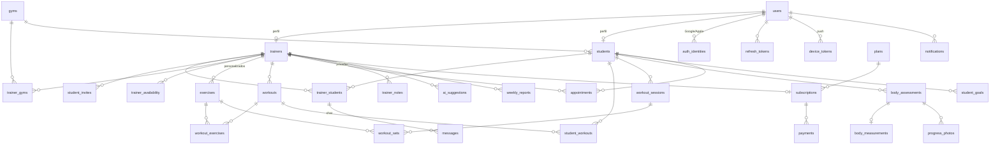

# Banco de dados (PostgreSQL)

Fonte da verdade: [`apps/api/prisma/schema.prisma`](../apps/api/prisma/schema.prisma).
SQL gerado: [`apps/api/prisma/migrations`](../apps/api/prisma/migrations).

Convenções: chaves `uuid`, tabelas/colunas em `snake_case`, pesos em kg, medidas
em cm, durações em segundos, dinheiro em centavos, datas em UTC.

## Diagrama



## Tabelas

| Tabela | Finalidade |
| --- | --- |
| `users` | Conta (e-mail, hash de senha, papel `STUDENT`/`TRAINER`/`ADMIN`, consentimentos LGPD, exclusão lógica) |
| `auth_identities` | Vínculos de login social (Google, Apple) |
| `refresh_tokens` | Refresh tokens (somente hash SHA-256), rotação e revogação |
| `password_reset_tokens` | Recuperação de senha (hash, expiração 1 h, uso único) |
| `device_tokens` | Tokens FCM por dispositivo |
| `trainers` | Perfil do professor: CREF, especialidades, bio, experiência, redes sociais, código de convite, avaliação média |
| `gyms` / `trainer_gyms` | Academias e onde cada professor atende |
| `trainer_availability` | Horários disponíveis por dia da semana |
| `students` | Perfil do aluno: nascimento, sexo, altura, pesos inicial/atual, objetivo, nível, frequência, academia |
| `trainer_students` | **Vínculo professor ⇄ aluno** (status, início do acompanhamento). Fronteira multi-tenant e conversa do chat |
| `student_invites` | Convites por código, QR Code, e-mail ou WhatsApp |
| `trainer_reviews` | Avaliações do professor feitas pelos alunos |
| `exercises` | Biblioteca global (`trainer_id` nulo) e exercícios personalizados do professor |
| `workouts` | Fichas (Treino A, B, C… ou divisão personalizada) |
| `workout_exercises` | Prescrição: séries, repetições, carga sugerida, descanso, técnica, agrupamento (bi-set/tri-set), observações |
| `student_workouts` | Atribuição de fichas a alunos (dias da semana, ordem, vigência) |
| `workout_sessions` | Execução: início, fim, duração, volume total, calorias estimadas, esforço |
| `workout_sets` | Séries realizadas: carga, repetições, RPE, observações, recorde pessoal |
| `body_assessments` | Avaliação física (agendada/concluída): peso, altura, IMC, % gordura, massa muscular, massa magra, gordura visceral |
| `body_measurements` | 12 medidas corporais (1:1 com a avaliação) |
| `progress_photos` | Fotos frente/costas/laterais por avaliação (comparação antes × depois) |
| `student_goals` | Metas (peso, % gordura, frequência, carga em exercício, personalizada) com progresso |
| `appointments` | Agenda: horário disponível, solicitado, confirmado, cancelado, concluído |
| `messages` | Chat privado (texto, imagem, vídeo, áudio, arquivo; marcador "dúvida") |
| `notifications` | Notificações in-app/push com deduplicação |
| `trainer_notes` | Anotações privadas do professor |
| `ai_suggestions` | Sugestões da IA aguardando aprovação do professor |
| `weekly_reports` | Relatórios semanais gerados automaticamente |
| `plans` / `subscriptions` / `payments` | Planos SaaS, assinatura do professor e faturamento |
| `files` | Metadados de uploads (chave no storage, MIME, tamanho, dono) |
| `audit_logs` | Trilha de auditoria (login, exportação/exclusão de dados, acesso a dados sensíveis) |

## Isolamento de dados

1. Professor → aluno: somente com `trainer_students` ativo/pendente (`AccessPolicyService.assertTrainerCanAccessStudent`).
2. Aluno → apenas registros com o próprio `student_id`.
3. Exercícios: `trainer_id IS NULL OR trainer_id = :trainerId`.
4. Fichas, anotações, sugestões e relatórios: sempre filtrados por `trainer_id`.
5. Chat: o usuário precisa ser o professor ou o aluno do vínculo da conversa.
6. Admin: acesso agregado (métricas), sem leitura de conteúdo privado (anotações, mensagens).

## Comandos

```bash
npm run db:up        # sobe o PostgreSQL (docker compose)
npm run db:migrate   # aplica migrações (prisma migrate dev)
npm run db:seed      # planos, biblioteca de exercícios e contas demo
```
